# UML Architecture - FunshiEngineCLI

UML architecture documentation for the FunshiEngineGL engine CLI and its
Silvy agent. Complements [../ARQUITECTURA.md](../ARQUITECTURA.md) (prose,
Spanish) and [DiagramaClases.eng.md](DiagramaClases.eng.md) (classes).

Conventions:
- **Language**: English; the primary (Spanish) version is [ArquitecturaUML.es.md](ArquitecturaUML.es.md)
- **Format**: Mermaid (diagrams embedded in Markdown)
- **Relations**: `-->` dependency/call, `-.->` asynchronous or via callback, `==>` external process

> Note: names with special characters (`::`, `()`, `/`) are quoted for Mermaid.

## 1. Layer Diagram

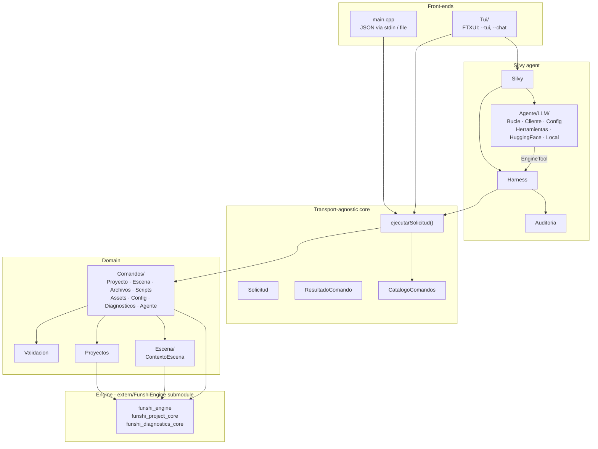

## 2. Component Diagram

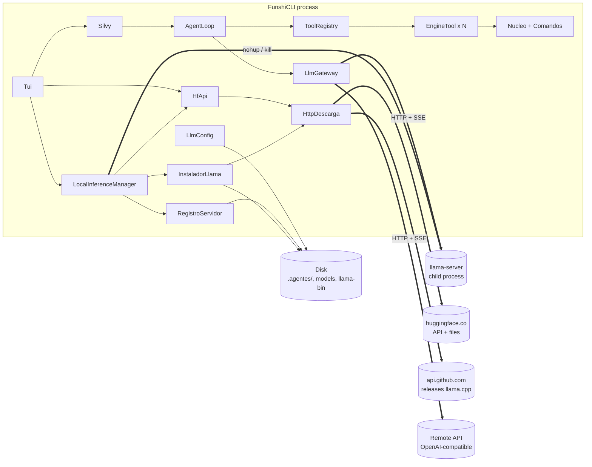

## 3. Sequence Diagrams

### 3.1 JSON request

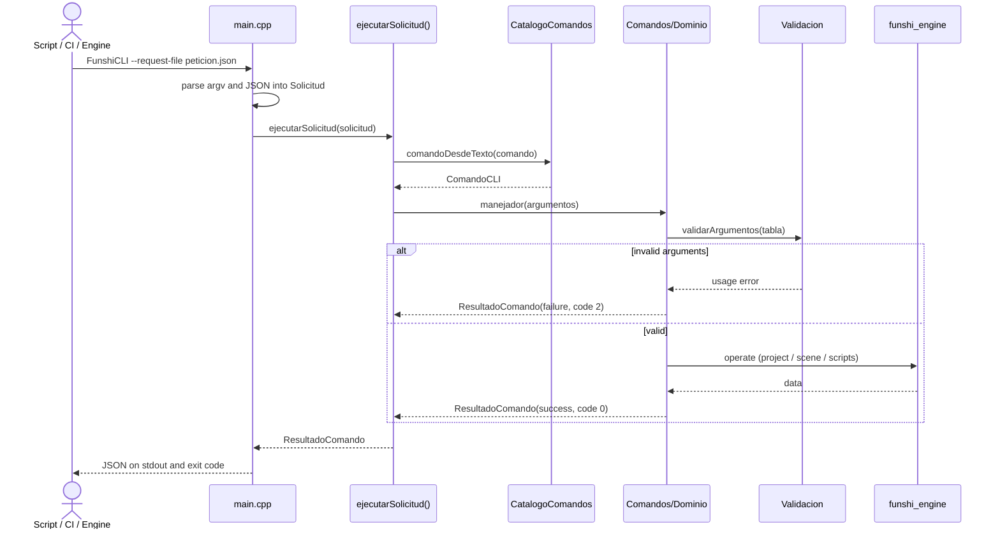

### 3.2 Chat with Silvy and a tool call

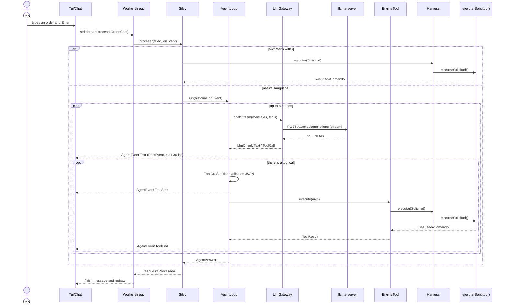

### 3.3 Install and activate a model

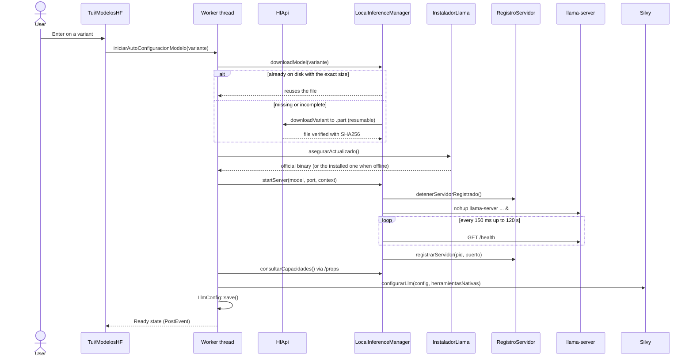

### 3.4 TUI exit and signals

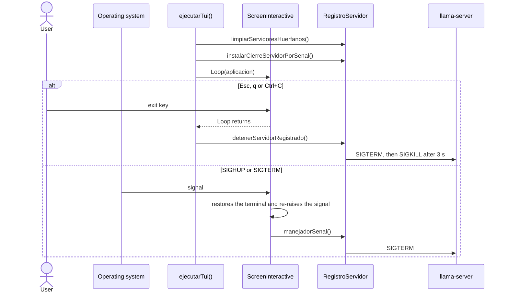

### 3.5 Copy the selected text

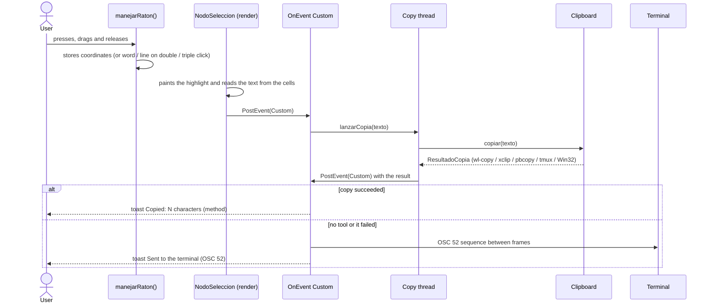

## 4. State Diagrams

### 4.1 TUI Models section

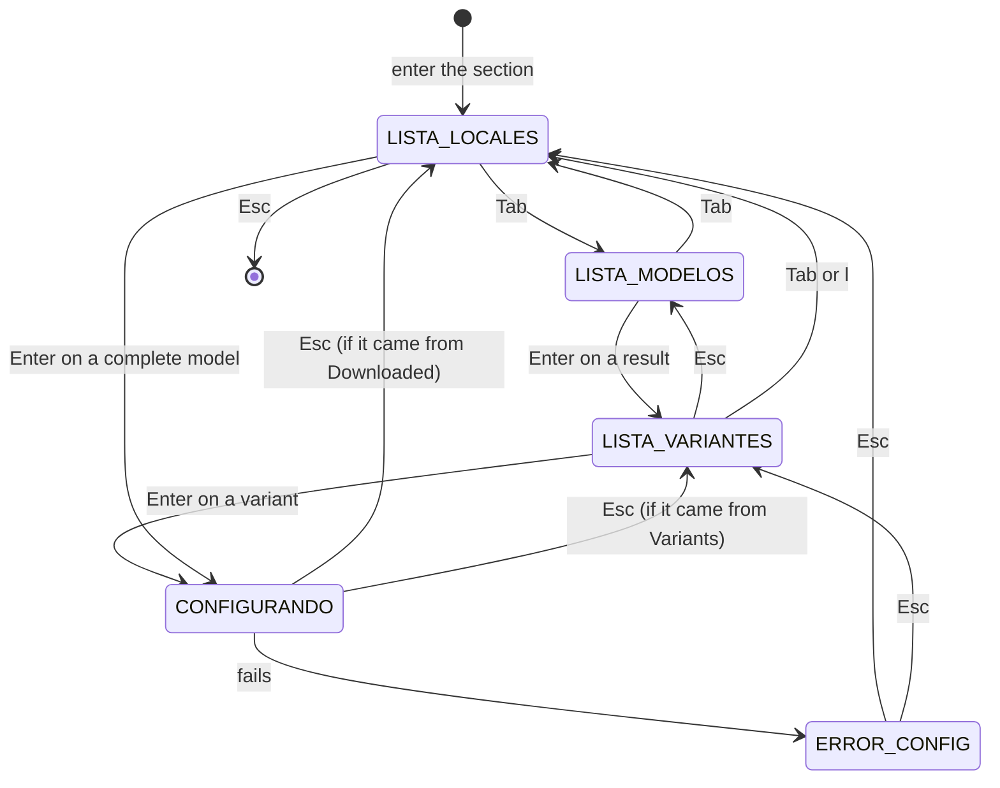

### 4.2 LocalInferenceManager

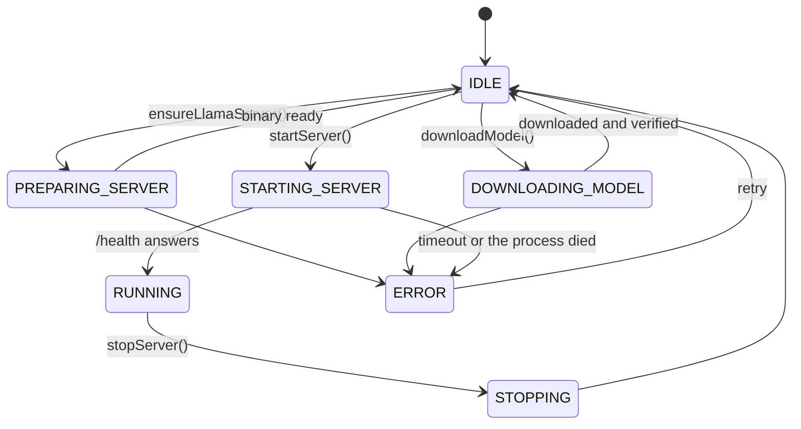

## 5. Deployment Diagram (processes and threads)

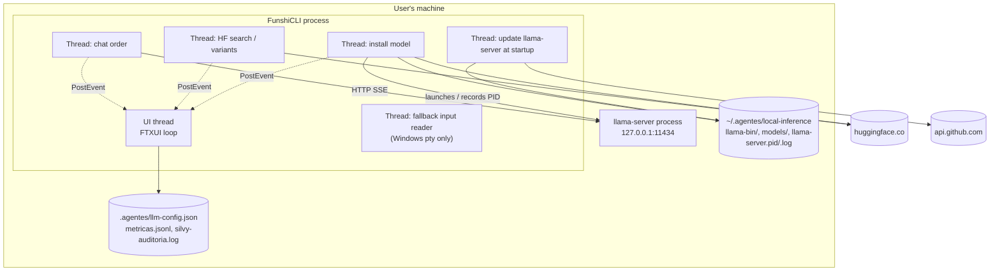

## 6. External Dependencies

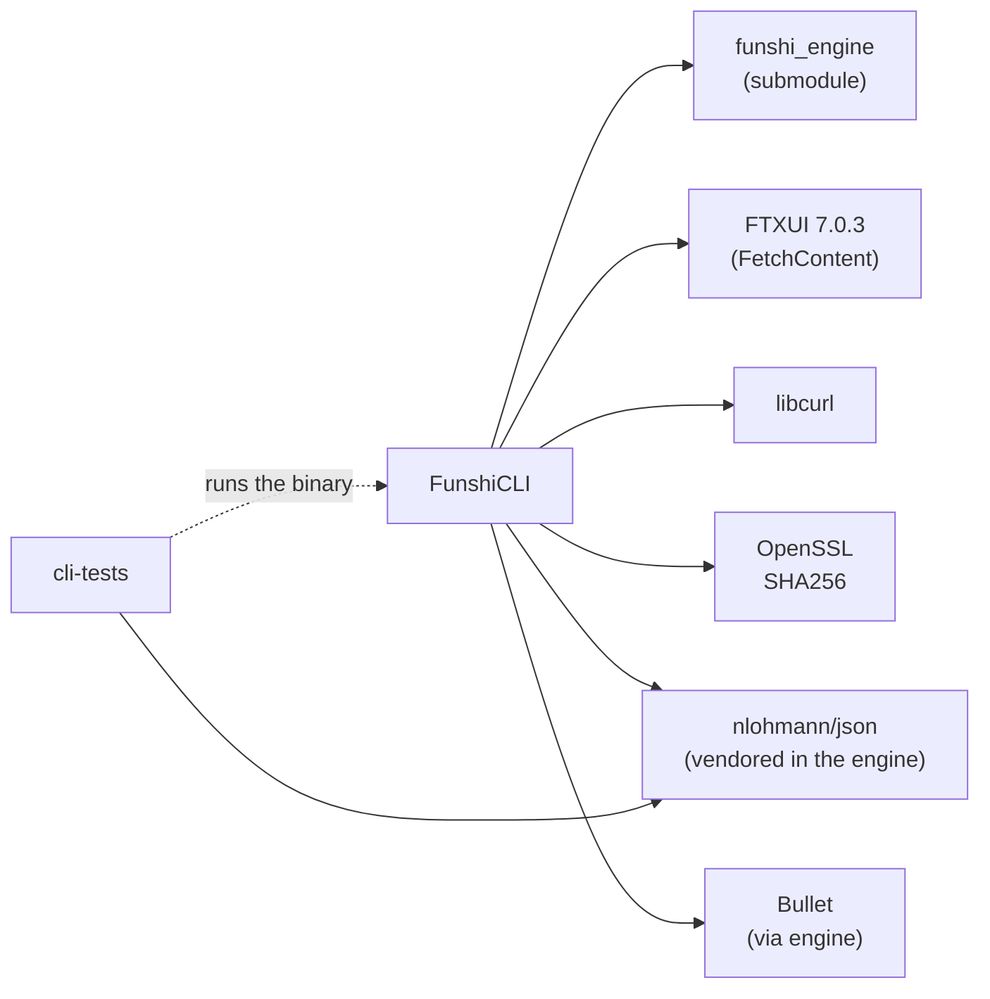

## 7. Identified Design Patterns

| Pattern | Where | Purpose |
|---|---|---|
| **Command** (request as object) | `Solicitud` → `ejecutarSolicitud()` | A single path for JSON, TUI and agent |
| **Enum + exhaustive switch** | `ComandoCLI`, `NucleoCLI.cpp` | The compiler warns about a missing command |
| **Strategy** | `LlmGateway` (`OpenAiCompatibleGateway`) | Swap the LLM backend without touching the loop |
| **Registry** | `ToolRegistry` | Tool catalog by name with cached specs |
| **Template Method** | `EngineTool::executeCommand()` | Every tool goes through `Harness` the same way |
| **Factory** | `createEngineToolRegistry()` | Builds the engine tool registry |
| **Facade** | `Harness`, `LocalInferenceManager`, `HfApi` | Hide auditing, processes and HTTP |
| **RAII** | `ContextoEscena`, `TempPruebas::CarpetaPrueba` | Ordered construction and destruction |
| **Pimpl** | `HfApi::Impl` (`HfApiImpl.h`) | Keeps cURL out of the public header |
| **Observer (callbacks)** | `AgentEvent`, `ProgressCallback`, `PostEvent` | The TUI learns about progress without coupling |
| **Validation table** | `RequisitoArg` | Arguments are declared, not hand-coded |
