# Arquitectura UML - FunshiEngineCLI

Documentación de arquitectura en formato UML de la CLI del motor FunshiEngineGL
y de su agente Silvy. Complementa a [../ARQUITECTURA.md](../ARQUITECTURA.md)
(texto) y a [DiagramaClases.es.md](DiagramaClases.es.md) (clases).

Convenciones:
- **Idioma**: español (idioma principal del repositorio); versión en inglés en [ArquitecturaUML.eng.md](ArquitecturaUML.eng.md)
- **Formato**: Mermaid (diagramas directamente en Markdown)
- **Relaciones**: `-->` dependencia/llamada, `-.->` asíncrono o por callback, `==>` proceso externo

> Nota: los nombres con caracteres especiales (`::`, `()`, `/`) van entre comillas para Mermaid.

## 1. Diagrama de Capas

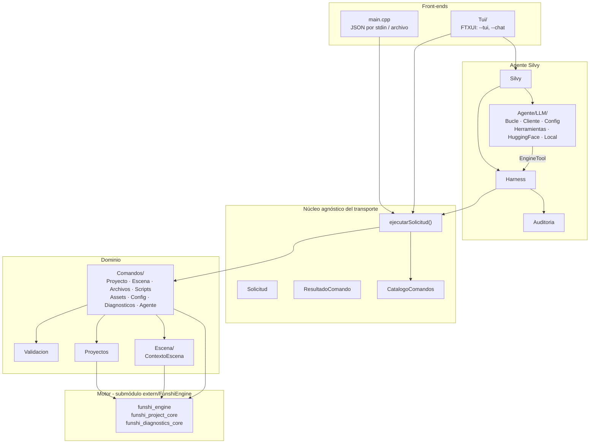

## 2. Diagrama de Componentes

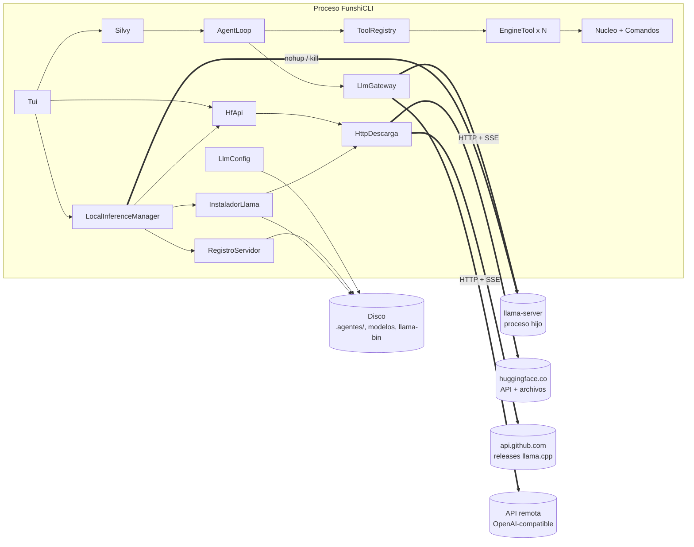

## 3. Diagramas de Secuencia

### 3.1 Petición JSON

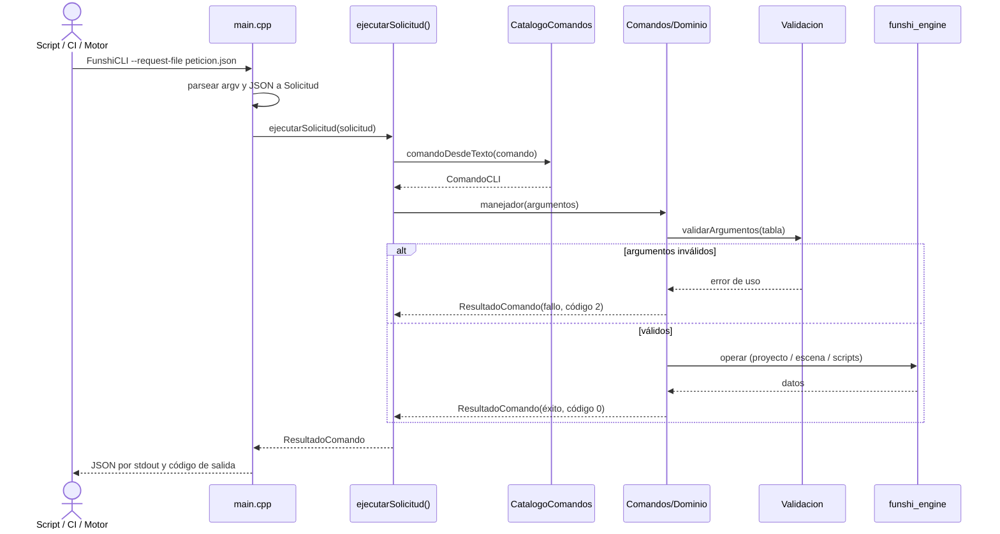

### 3.2 Chat con Silvy y llamada a herramienta

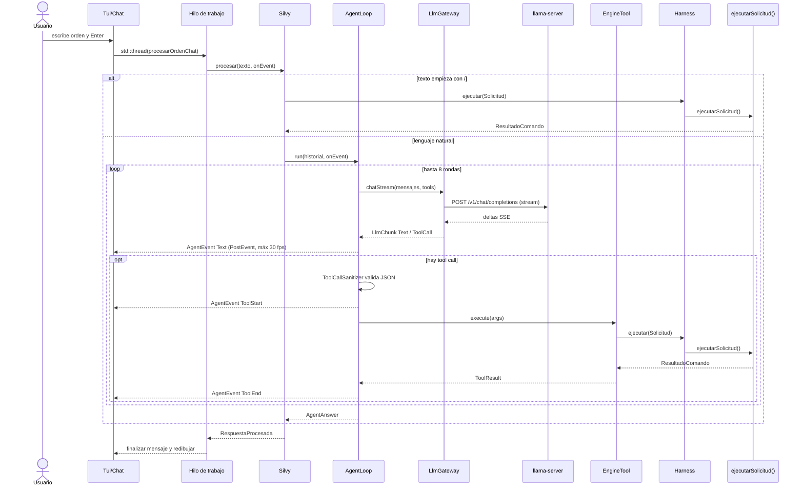

### 3.3 Instalar y activar un modelo

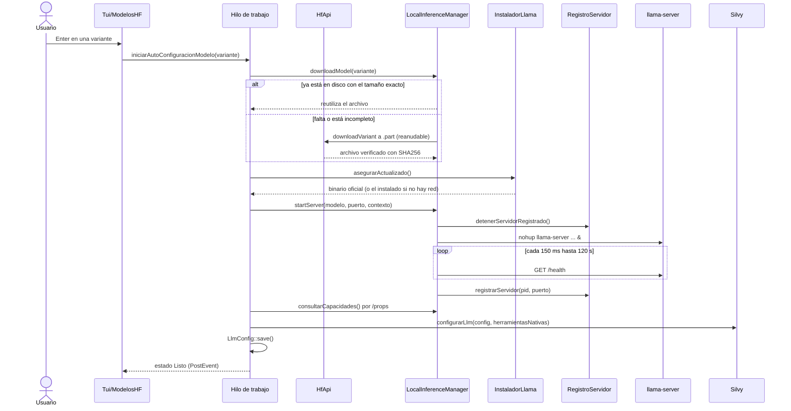

### 3.4 Salida de la TUI y señales

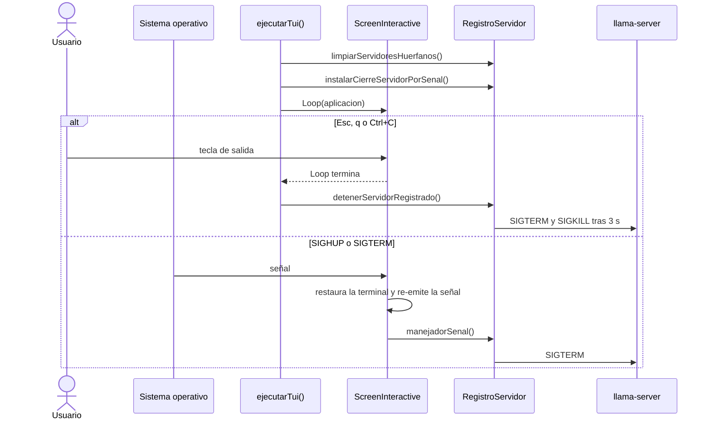

### 3.5 Copiar el texto seleccionado

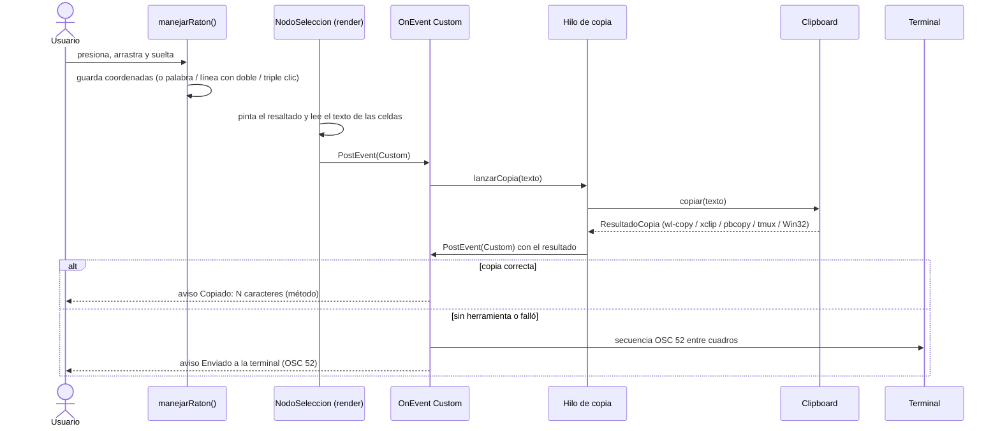

## 4. Diagramas de Estados

### 4.1 Sección Modelos de la TUI

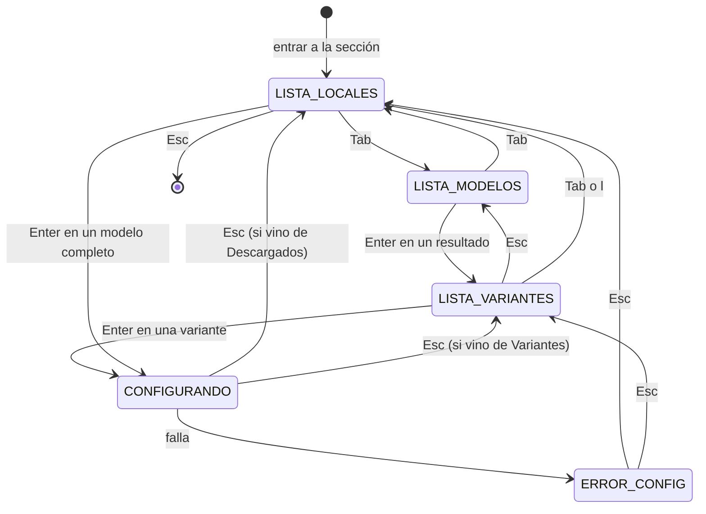

### 4.2 LocalInferenceManager

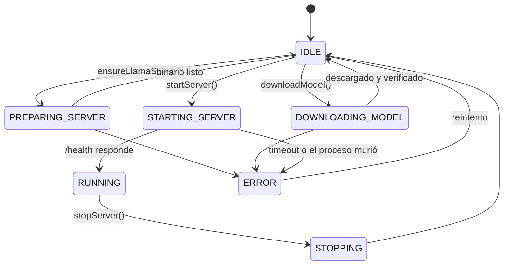

## 5. Diagrama de Despliegue (procesos e hilos)

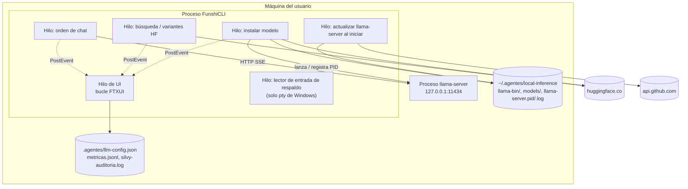

## 6. Dependencias Externas

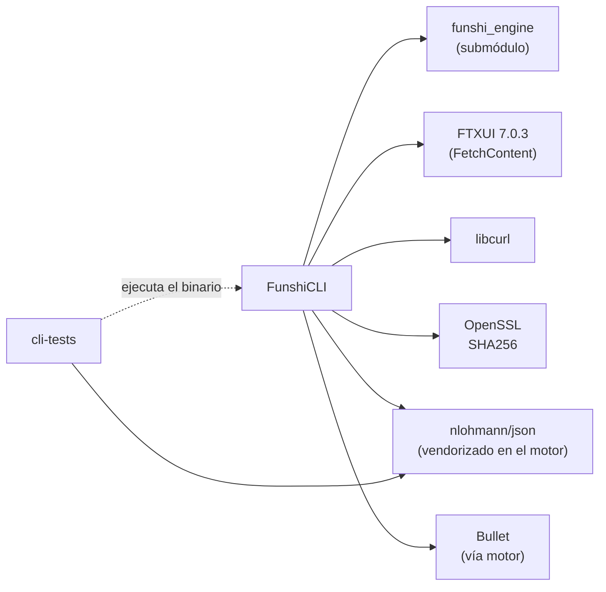

## 7. Patrones de Diseño Identificados

| Patrón | Dónde | Para qué |
|---|---|---|
| **Command** (petición como objeto) | `Solicitud` → `ejecutarSolicitud()` | Un único camino para JSON, TUI y agente |
| **Enum + switch exhaustivo** | `ComandoCLI`, `NucleoCLI.cpp` | El compilador avisa si falta un comando |
| **Strategy** | `LlmGateway` (`OpenAiCompatibleGateway`) | Cambiar de backend LLM sin tocar el bucle |
| **Registry** | `ToolRegistry` | Catálogo de herramientas por nombre con caché de specs |
| **Template Method** | `EngineTool::executeCommand()` | Todas las tools pasan por `Harness` igual |
| **Factory** | `createEngineToolRegistry()` | Arma el registro de herramientas del motor |
| **Facade** | `Harness`, `LocalInferenceManager`, `HfApi` | Esconden auditoría, procesos y HTTP |
| **RAII** | `ContextoEscena`, `TempPruebas::CarpetaPrueba` | Construcción y destrucción ordenadas |
| **Pimpl** | `HfApi::Impl` (`HfApiImpl.h`) | Aísla cURL del header público |
| **Observer (callbacks)** | `AgentEvent`, `ProgressCallback`, `PostEvent` | La TUI se entera del progreso sin acoplarse |
| **Tabla de validación** | `RequisitoArg` | Argumentos declarados, no programados |
