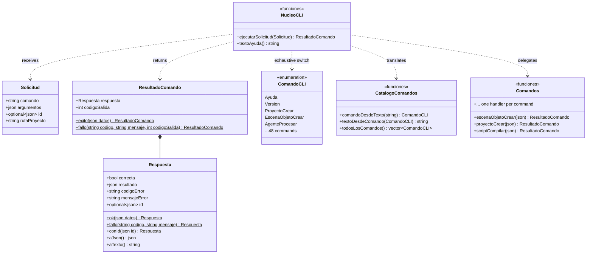
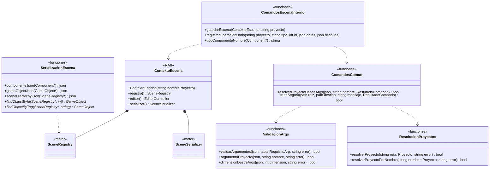
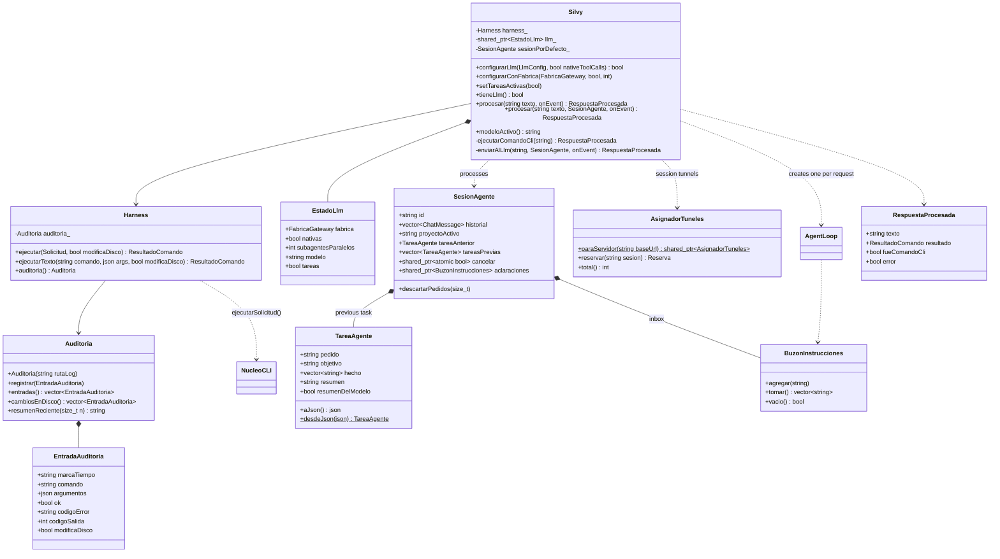
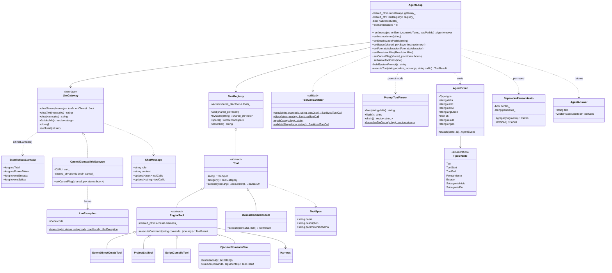
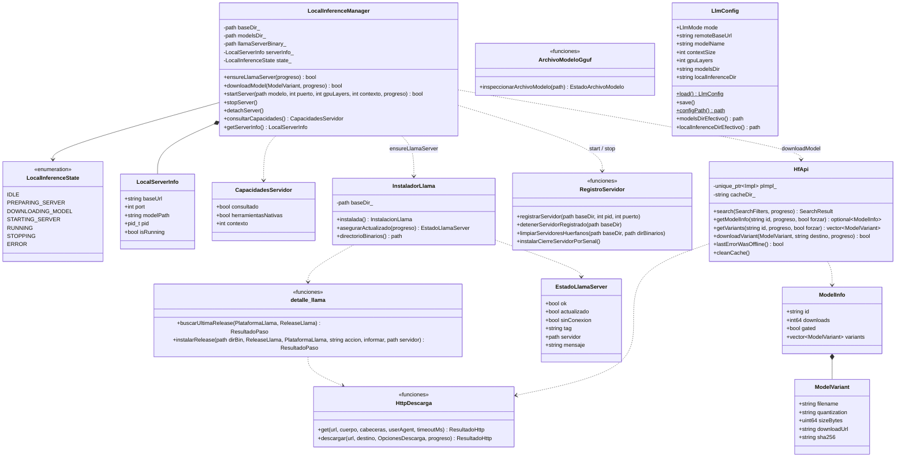
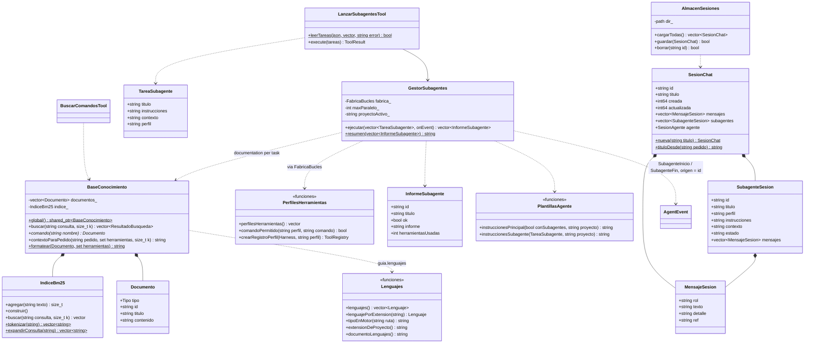
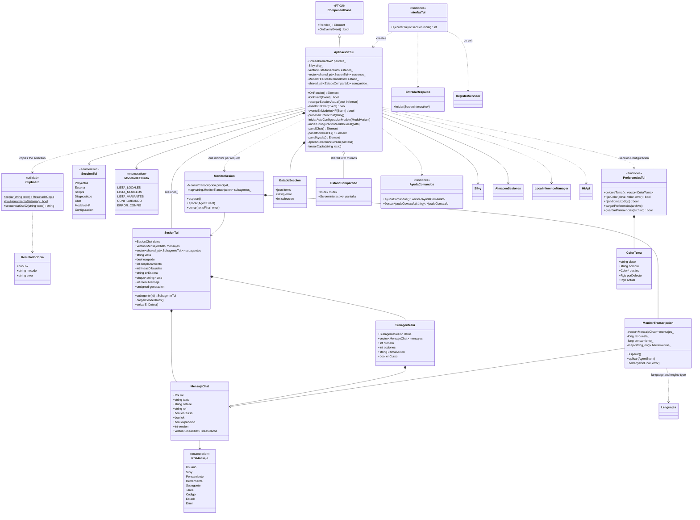
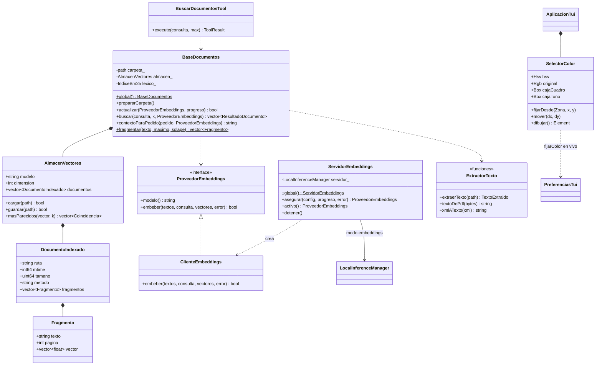

# Class Diagram - FunshiEngineCLI

Main CLI classes and structs, grouped by module. Each diagram shows the
relevant public API (not every private member). Overall architecture in
[ArquitecturaUML.eng.md](ArquitecturaUML.eng.md).

Conventions:
- **Language**: English; the primary (Spanish) version is [DiagramaClases.es.md](DiagramaClases.es.md)
- **Format**: Mermaid `classDiagram`
- **Relations**: `<|--` inheritance, `*--` composition, `o--` aggregation, `-->` association, `..>` dependency
- A module's free functions are grouped in a class with the `<<funciones>>` (functions) stereotype

## 1. Core: request, response and dispatch

## 2. Domain: scene, validation and projects

## 3. Agent: Silvy, Harness and Auditing

## 4. Agente/LLM: loop, tools and client

> There are 23 `EngineTool` tools (project, scene, files, scripts, assets,
> diagnostics); the diagram shows three. All of them are created by
> `createEngineToolRegistry(harness)`.

## 5. Agente/LLM: local inference and Hugging Face

## 6. Knowledge, subagents and sessions

## 7. TUI

## 8. User documents and color picker

