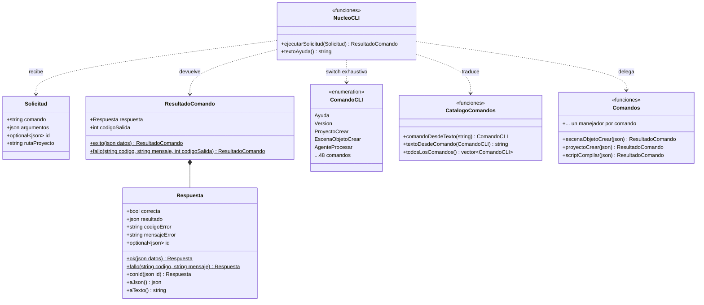
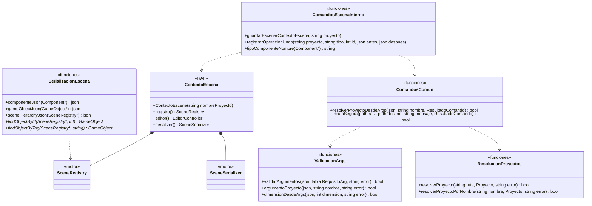
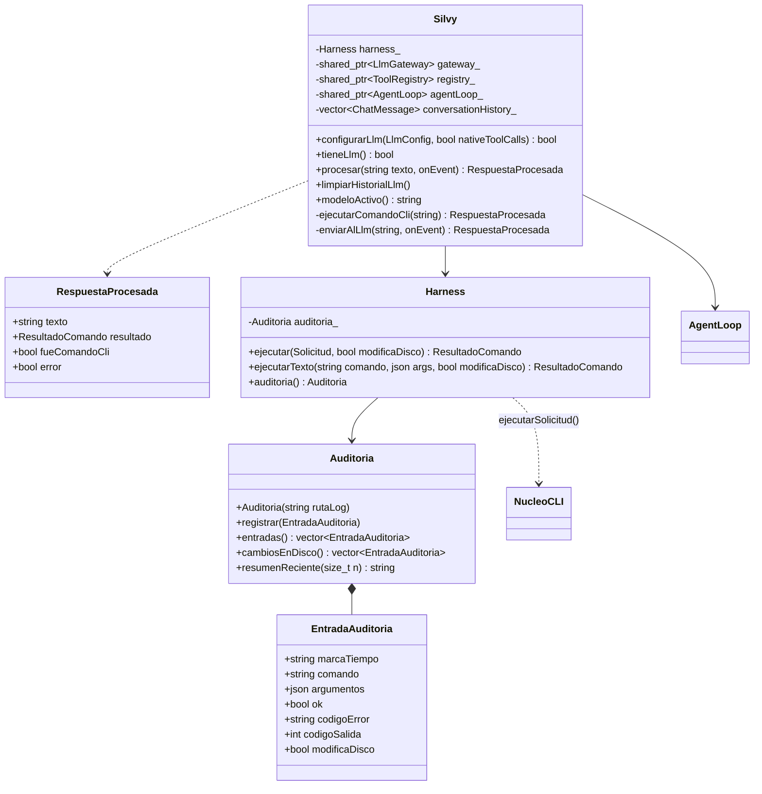
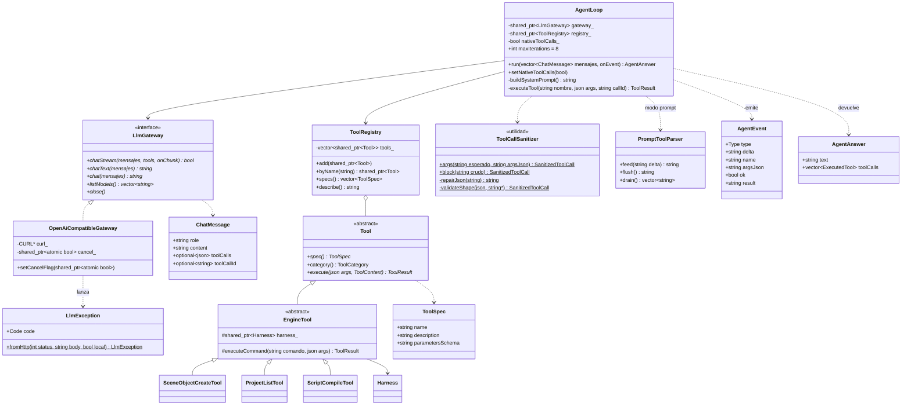
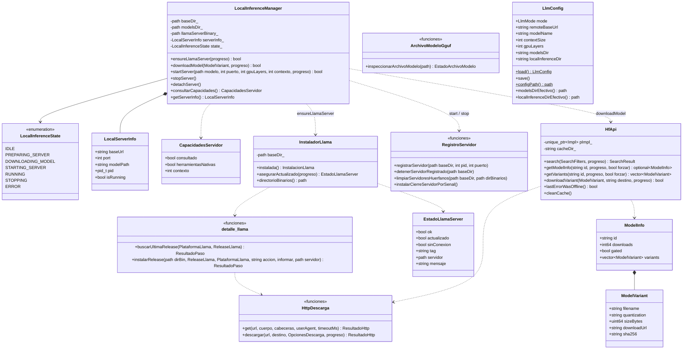
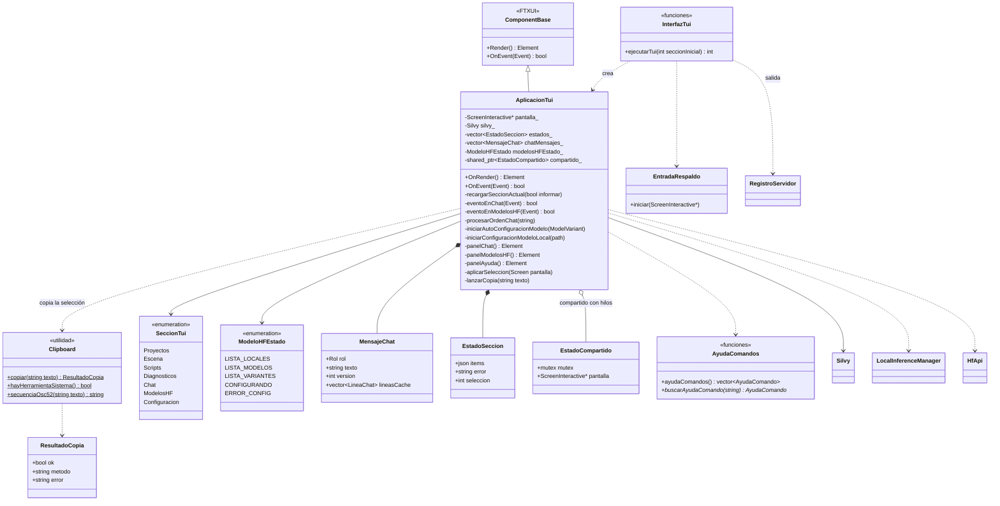

# Diagrama de Clases - FunshiEngineCLI

Clases y estructuras principales de la CLI, agrupadas por módulo. Cada
diagrama muestra la API pública relevante (no todos los miembros privados).
Arquitectura general en [ArquitecturaUML.es.md](ArquitecturaUML.es.md).

Convenciones:
- **Idioma**: español; versión en inglés en [DiagramaClases.eng.md](DiagramaClases.eng.md)
- **Formato**: Mermaid `classDiagram`
- **Relaciones**: `<|--` herencia, `*--` composición, `o--` agregación, `-->` asociación, `..>` dependencia
- Las funciones libres de un módulo se agrupan en una clase con estereotipo `<<funciones>>`

## 1. Núcleo: petición, respuesta y dispatch

## 2. Dominio: escena, validación y proyectos

## 3. Agente: Silvy, Harness y Auditoría

## 4. Agente/LLM: bucle, herramientas y cliente

> Hay 23 herramientas `EngineTool` (proyecto, escena, archivos, scripts,
> assets, diagnósticos); el diagrama muestra tres. Todas las crea
> `createEngineToolRegistry(harness)`.

## 5. Agente/LLM: inferencia local y Hugging Face

## 6. TUI

